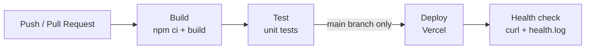
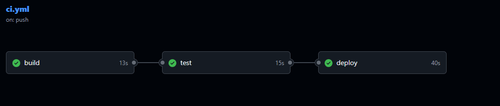
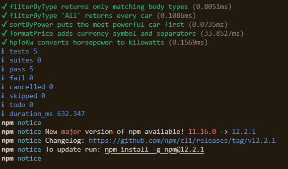
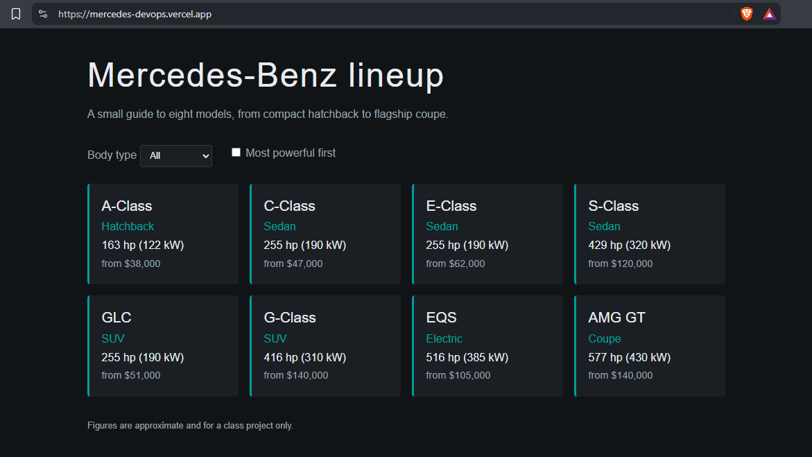

# Mercedes-Benz Lineup: DevOps Pipeline Project

## Project description
A small static website (HTML, CSS, vanilla JavaScript) that lists eight Mercedes-Benz models.
Visitors can filter by body type and sort by power. The car data and logic live in
`src/cars.js` so they can be unit tested; `src/app.js` only renders them in the browser.

**Tools:** HTML/CSS/JS, Node.js, Git, GitHub, GitHub Actions, Vercel, curl.

**Live site:** https://mercedes-devops.vercel.app

## Repository layout
```
index.html, style.css      the website
src/cars.js                logic, unit tested
src/app.js                 renders the page in the browser
test/cars.test.js          unit tests
scripts/build.js           build step: copies the site to dist/
scripts/healthcheck.sh     health check, writes logs/health.log
.github/workflows/ci.yml   CI/CD pipeline
```

## Git workflow
Two branches are used: `dev` for day-to-day work and `main` for the deployed version.
Changes are committed to `dev` often, then merged into `main` (via Pull Request), which triggers deployment.

## CI/CD process
The workflow in `.github/workflows/ci.yml` runs on every push and pull request to `main` and `dev`.

1. **Build:** checks out the code, sets up Node.js 20, installs dependencies (`npm ci`), runs `npm run build` and uploads the `dist/` folder as an artifact.
2. **Test:** runs the unit tests with `npm test` (Node's built-in test runner). If any test fails, the pipeline stops.
3. **Deploy:** runs only on pushes to `main`, after tests pass. It downloads `dist/` and deploys it to Vercel with the Vercel CLI, using secrets stored in GitHub.

After deploying, `scripts/healthcheck.sh` requests the live site with `curl` and appends the result
(OK or FAIL, timestamp, HTTP status) to `logs/health.log`. The log is uploaded as a pipeline artifact.



## Screenshots

### Successful 3-stage pipeline

GitHub Actions run with Build, Test and Deploy all green.

### Unit tests passing

utput of `npm test` showing all tests passing.

### Running application

the deployed site on Vercel.

## Run locally
```bash
npm test          # run unit tests
npm run build     # build into dist/
bash scripts/healthcheck.sh https://example.com   # try the health check
```
